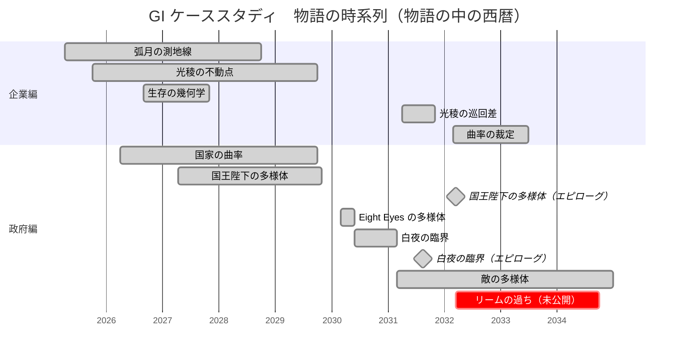

# 物語の時系列 ── GI ケーススタディ年表

各ケーススタディの物語は、同じ世界の、同じ時間の流れの中で起きている。下の図は、物語の中の西暦で、各作品の始まりから終わりまでを棒で示したものである（GitHub の Mermaid で描画）。複数の案件が同じ時期に並行していることが分かる。

**登場人物の年齢**（物語の中の各年。リームは2031年に34歳、リルル教授は2031年に66歳）

| 西暦 | 2025 | 2026 | 2027 | 2028 | 2029 | 2030 | 2031 | 2032 | 2033 | 2034 | 2035 | 2036 |
|---|---|---|---|---|---|---|---|---|---|---|---|---|
| リームの年齢 | 28歳 | 29歳 | 30歳 | 31歳 | 32歳 | 33歳 | 34歳 | 35歳 | 36歳 | 37歳 | 38歳 | 39歳 |
| リルル教授の年齢 | 60歳 | 61歳 | 62歳 | 63歳 | 64歳 | 65歳 | 66歳 | 67歳 | 68歳 | 69歳 | 70歳 | 71歳 |

| 区分 | 作品 | 分野 | 物語の期間 | 状態 |
|---|---|---|---|---|
| 企業編 | 弧月の測地線 | 建設（弧月建設） | 2025年4月 〜 2028年9月 | 公開済み |
| 企業編 | 光稜の不動点 | 半導体製造装置（光稜精機） | 2025年10月 〜 2029年9月 | 公開済み |
| 政府編 | 国家の曲率 | 日本政府（経済安全保障） | 2026年4月 〜 2029年9月 | 公開済み |
| 企業編 | 生存の幾何学 | 繊維（綾鳥テキスタイル） | 2026年8月 〜 2027年10月 | 公開済み |
| 政府編 | 国王陛下の多様体 | 英国政府（国家レジリエンス） | 2027年4月 〜 2029年10月（エピローグは2032年3月） | 公開済み |
| 政府編 | Eight Eyes の多様体 | ８か国のインテリジェンス統合 | 2030年3月 〜 2030年5月 | 公開済み |
| 政府編 | 白夜の臨界 | 北極海の LNG と海上保険 | 2030年6月 〜 2031年2月（物語は2030年夏〜2031年2月。エピローグは2031年8月） | 公開済み |
| 政府編 | 敵の多様体 | 中国（双対多様体） | 2031年3月 〜 2034年12月（エピローグは2034年の暮れ） | 公開済み |
| 企業編 | 光稜の巡回差 | 半導体製造装置（光稜精機・第２作） | 2031年4月 〜 2031年10月 | 公開済み |
| 企業編 | 曲率の裁定 | ヘッジファンド（MUCAM） | 2032年3月 〜 2033年6月 | 公開済み |
| 政府編 | リームの過ち | Eight Eyes の手術計画とコンゴ | 2032年3月 〜 2034年9月（年代は2026年11月10日に決定） | 未公開（草稿） |

- 物語の期間は、各作品の章の見出しの日付（プロローグからエピローグまで）にもとづく。物語の外の、過去の出来事の回想（例：敵の多様体の「天網の構築 ── 2024年〜2028年」）は含めない
- エピローグが本編から大きく離れている作品は、◆（マイルストーン）でエピローグの時期を示した
- 同じ内容の PDF 版（図の横軸の下に、各年のリームとリルル教授の年齢を記載）：[timeline.pdf](timeline.pdf)

## 著者

Étale Cohomology

## ライセンス

License: Creative Commons Attribution 4.0 International (CC BY 4.0)
